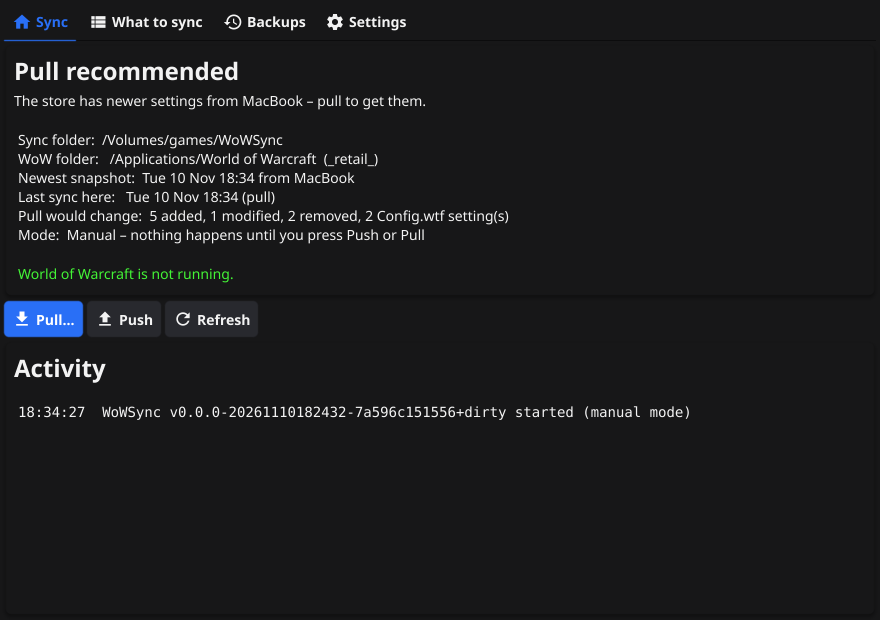
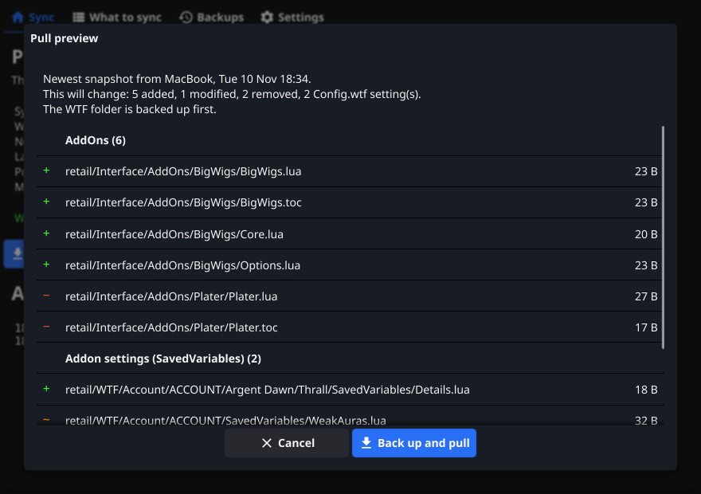

# WoWSync – designveileder

Denne veilederen forklarer hvordan WoWSync er bygget og hvorfor. Den viser også hva du kan
endre i design og oppførsel uten å rive noe ned. Selve programmet er på engelsk.



## 1. Kort fortalt

- Hver maskin har sin egen config (sync-mappe, WoW-mappe, kategorier). Ingenting av dette
  ligger i GitHub.
- **Push** lager et nytt *øyeblikksbilde* (snapshot) av det maskinen synker, i en delt mappe på NAS-en.
- **Pull** viser hva som vil endres. Når du bekrefter, tas det backup av `WTF`, og så skrives
  det nyeste øyeblikksbildet til disk.
- GitHub-repoet inneholder bare kildekoden. Releases bygges der.

## 2. Arkitektur

```
cmd/wowsync         CLI (ren Go, uten cgo)
cmd/wowsync-gui     Fyne-app (vindu + tray), tar også imot CLI-kommandoer
internal/wow        WoW-kunnskap: flavors, kategorier, ekskludering, Config.wtf/CVar, prosess-sjekk
internal/store      Lagring: Store-grensesnitt + Folder (NAS/delt mappe)
internal/config     Config per maskin, standardstier per OS
internal/syncer     Motoren: skann, diff, push, pull, backup, gjenoppretting, status, WoW-vakt
internal/cli        Kommandolinja
internal/gui        Alt som har med Fyne å gjøre
```

Regelen er at **all logikk ligger i `syncer`, `store` og `wow`**. GUI og CLI er tynne lag som
kaller `PlanPull` → viser forhåndsvisning → `Pull`, og `PlanPush` → `Push`. Dermed kan alt
testes med `go test` uten cgo, og CLI og GUI oppfører seg likt.

## 3. Lagringsformat (NAS-mappen)

```
WoWSync/
  wowsync-store.json              markør, skrives én gang
  snapshots/<tid>_<maskin>_<id>.json.gz
  objects/ab/abcdef…              gzip-komprimert filinnhold, navngitt etter SHA-256
```

- **Filer skrives én gang og endres aldri.** Det gjør formatet trygt på SMB/NAS og i skymapper:
  to maskiner kan ikke ødelegge den samme filen.
- Like filer lagres bare én gang. En addon som ikke endres, koster ingenting ekstra ved ny push.
- Alt skrives via en temp-fil og `rename`, slik at andre maskiner aldri ser halvskrevne filer.
- Innholdet verifiseres mot SHA-256 når det leses.
- **Markørfilen** beskytter mot en vanlig feil: Er NAS-en ikke montert, finnes ikke
  `/Volumes/games/WoWSync`, og WoWSync nekter å skrive i stedet for å fylle opp den lokale disken.
- `Prune` (i Settings eller `wowsync prune`) beholder de N nyeste øyeblikksbildene og sletter data
  som ingen av dem bruker lenger.

**Andre lagringstyper senere:** `store.Store` er et lite grensesnitt (List/Get/Put/HasObject/
PutObject/GetObject/Prune). S3/R2, WebDAV eller et eget git-repo kan legges til ved siden av
`Folder`. Trenger de passord eller token, lagres det i OS-ets nøkkelring (f.eks.
`github.com/zalando/go-keyring`) og aldri i config-filen.

## 4. Synkmodellen

| Begrep | Betydning |
|---|---|
| Øyeblikksbilde | Fullstendig liste over sti → hash, pluss delte CVars per flavor |
| Siste synk (`state.json`) | Øyeblikksbildet denne maskinen sist pushet eller pullet |
| Konflikt | Lageret har et nyere øyeblikksbilde enn det maskinen sist synket |

- **Push** tar det nyeste øyeblikksbildet og erstatter bare det *denne* maskinen styrer.
  Andre flavors, avslåtte kategorier og filer som er ekskludert her, beholdes. En maskin som
  bare har `_retail_`, sletter altså ikke `_classic_` fra lageret.
- **Konflikt** stopper push med valgene *Pull first* eller *Push anyway*. «Push anyway» lager et
  nytt øyeblikksbilde oppå det andre, så det gamle ligger fortsatt i historikken. I automatisk
  modus løses konflikter aldri; du får bare et varsel.
- **Pull** gjelder også bare det maskinen styrer. Lokale filer i avslåtte kategorier røres ikke.
- **Status/anbefaling:** *In sync*, *Pull recommended*, *Push recommended*, *Changed on both
  sides*, *First sync* eller *Store is empty*. Knappen som anbefales, er uthevet.

## 5. Hva synkes

Det skannes bare i `WTF/` og `Interface/AddOns/` i hver flavor. Kategorier (først treff vinner):

| Kategori | Mønster (relativt til `_retail_`) |
|---|---|
| AddOns | `Interface/AddOns/**`, `WTF/Account/*/*/*/AddOns.txt` |
| Addon settings | `WTF/Account/*/SavedVariables/**`, `WTF/Account/*/*/*/SavedVariables/**` |
| Key bindings | `WTF/Account/**/bindings-cache.wtf` |
| Macros | `WTF/Account/**/macros-cache.txt` |
| Chat windows | `WTF/Account/**/chat-cache.txt` |
| Account & character settings | `config-cache.wtf`, `layout-local.txt` |
| Client settings | `WTF/Config.wtf` – flettes per CVar |
| Other WTF files | resten av `WTF/**` |

**Alltid ekskludert:** `/Cache/`, `/Logs/`, `/Errors/`, `/Screenshots/`, `*.bak`, `*.old`,
`*.tmp`, `._*`, `.DS_Store`, `Thumbs.db`, `desktop.ini`, `.git/`, `cache.md5`, pluss det du legger
inn under *Extra exclusions*.

### Config.wtf per CVar

`Config.wtf` blandes mellom maskiner i stedet for å kopieres:

1. Ved push lagres bare CVars som *ikke* står på maskinens lokal-liste, sammen med selve listen.
2. Ved pull oppdateres, legges til eller fjernes bare CVars som verken denne eller den pushende
   maskinen har på lokal-listen. Grafikk som `gxApi "D3D12"` på PC og `gxApi "metal"` på Mac
   blir derfor stående.
3. Standardlisten (`wow.DefaultLocalCVars`) dekker grafikk, vindu og skjerm, FPS, lydenhet og
   UI-skala. Du redigerer den under *What to sync* («Reset to defaults» henter standarden igjen).

## 6. Sikkerhet for dataene dine

- Pull **blokkeres** mens WoW kjører (Wow.exe, WowClassic.exe, «World of Warcraft» på Mac),
  fordi WoW overskriver SavedVariables når spillet avsluttes. CLI-en har `--force` for unntak.
- Før hver pull lages en **zip-backup** av hele `WTF` og av alle filer utenfor `WTF` som vil
  endres eller slettes. Backupen husker også hvilke filer pull-en la til.
- Ved **gjenoppretting** tas det først en ny backup, så filene legges tilbake og nye filer fjernes.
  Synk-tilstanden settes også tilbake. En gjenoppretting kan derfor angres.
- Stier fra lageret valideres (ingen `..`, ingen absolutte stier, ingen ugyldige Windows-navn).
- Filer skrives atomisk, og skrivebeskyttede SavedVariables håndteres.

## 7. Windows ↔ macOS

- **Linjeslutt:** Tekstfiler (`.lua`, `.txt`, `.wtf`, `.toc`, `.xml` …) lagres med LF. CRLF og LF
  regnes som like, så det oppstår ingen falske endringer.
- **Store/små bokstaver:** Stier sammenlignes uten hensyn til store og små bokstaver. Ved pull
  beholdes den lokale skrivemåten av filnavnet.
- **Unicode:** Stier normaliseres til NFC. macOS kan gi realmnavn med aksenter i NFD-form.
- **Store filer:** Over *Warn above* (20 MB) får du en advarsel. Over *Skip files above*
  (0 = av) hoppes filen over, og den eksisterende versjonen i lageret beholdes.

## 8. Brukergrensesnittet

Prinsipper:

1. **Ingenting skrives uten at du har sett det.** Pull går alltid via forhåndsvisningen, også i
   automatisk modus.
2. **Én anbefalt handling.** Statuskortet sier hva som er lurt, og den knappen er blå.
3. **Rolig i bakgrunnen.** Lukker du vinduet, går appen til tray. Varsler vises bare for
   automatiske handlinger.
4. **Forklar konsekvensen.** Dialogene sier hva som skjer med dataene, ikke bare «Er du sikker?».

| Fane | Innhold |
|---|---|
| Sync | Statuskort, Pull…/Push/Refresh og aktivitetslogg |
| What to sync | Kategorier, lokale CVars og ekstra ekskluderinger |
| Backups | Liste, Restore… og Open backup folder |
| Settings | Sync-mappe (med «Create store here»), WoW-mappe og spillversjoner, maskinnavn, modus og grenser |



Tray-menyen har *Open WoWSync*, *Pull…*, *Push*, *Automatic mode* (avkrysning) og *Quit*.

## 9. Visuell profil – slik endrer du den

| Element | Nå | Hvor |
|---|---|---|
| App-ikon | Navy avrundet kvadrat, gule synkpiler, blå diamant | `cmd/wowsync-gui/Icon.png` |
| Tray-ikon | Svarte synkpiler (SVG), farges av OS-tema | `internal/gui/tray.svg` |
| Farger | Navy `#283E6E`→`#0C1224`, gull `#F4C542`, blå `#78BEFF` | `tools/genicon.py` |
| Tema | Fyne-standard, følger lyst/mørkt i OS-et | `internal/gui` |

- **Nytt app-ikon:** Lag en PNG på 1024×1024 og legg viktige detaljer innenfor de midterste
  ~80 %. macOS runder av hjørnene selv i Dock, og Windows skalerer ned til 16 px. Lagre den som
  `cmd/wowsync-gui/Icon.png`; `fyne package` lager `.ico` og `.icns` automatisk. Eller endre
  fargene i `tools/genicon.py` og kjør `python3 tools/genicon.py` (krever Pillow).
- **Tray-ikon:** Bruk ensfarget svart med gjennomsiktig bakgrunn, enkle former og tykke streker
  (det vises i 16–22 px). Fyne farger det etter lyst eller mørkt tema.
- **Egne farger i appen:** Lag et `fyne.Theme` som overstyrer `theme.ColorNamePrimary` (f.eks. med
  gull eller blått fra ikonet), og sett det med `app.Settings().SetTheme(...)` i `gui.Run`.
  Sjekk kontrasten: hvit tekst på gull leses dårlig, så bruk gull som aksent og blått på knapper.
- **Tekster:** Alle tekster står direkte i `internal/gui/*.go` og `internal/syncer/status.go`.

## 10. Oppsett på NAS

- **Windows:** Bruk UNC-sti (`\\NAS\games\WoWSync`) eller koble til en nettverksstasjon med
  «Koble til igjen ved pålogging».
- **macOS:** Finder → *Gå* → *Koble til tjener* → `smb://nas/games`. Legg delingen til under
  *Systeminnstillinger → Generelt → Påloggingsobjekter*, så monteres den automatisk. Velg deretter
  `/Volumes/games/WoWSync`.
- Opprett lageret («Create store here») på én maskin. De andre peker bare på samme mappe.

## 11. Mulige neste steg

- Autostart ved innlogging (tray-modus med `--hidden`)
- Én instans om gangen (låsefil)
- Flere lagringstyper (S3/R2, WebDAV) med nøkkelring for hemmeligheter
- Advarsel når en pull vil slette veldig mange filer
- Kodesignering (Apple Developer ID og Authenticode) hvis appen skal deles med andre
